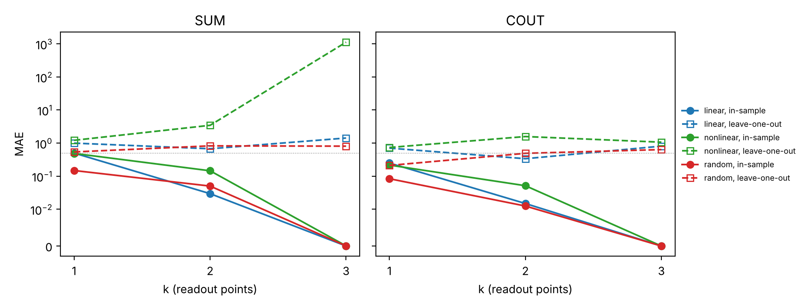

# magnonic-full-adder

[](https://github.com/Les-nik/magnonic-full-adder/actions/workflows/tests.yml)

MuMax3 / amumax simulations and readout analysis of a spin-wave full adder: three antennas
on a 60 nm YIG film, a row of nanoscale CoFeB "bowtie" resonators above it, and a linear
readout of the spin-wave field that should reproduce the SUM and carry-out (COUT) bits for
all eight input combinations.

Work done in the EU project MANNGA at Adam Mickiewicz University, Poznań. The results are in
a manuscript in preparation.

## How the device is simulated

* **Inputs.** Each bit (A, B, Cin) sets the amplitude of one antenna at 2.1 GHz: 1 mT for 0,
  5 mT for 1. An additional 0.5 mT drive field (`Amp_GMF`) is applied in every case.
* **Film and resonators.** YIG, 60 nm (12 cells of 5 nm), 1800 x 1300 cells in plane with
  absorbing boundary layers. Seven CoFeB bowtie resonators sit above the film.
* **Output.** After 25 ns the oscillation is in steady state. The magnetization of the top
  YIG layer is recorded and reduced to one complex phasor per cell (amplitude and phase at the
  drive frequency).

`simulations/` holds the scripts of the eight cases for three resonator types (bowtie,
uniformly magnetized disk, vortex disk). The eight files of one type differ only in the input
amplitudes A1, A2, A3, with one exception: in `bowtie/100.mx3` the absorbing-layer damping
profile is 0.5 instead of 0.25 and `MaxErr` is set. The files are kept as they were run.
`scripts/make_no_resonators.py` writes the control runs without resonators (one line changed
in each bowtie script).

## Analysis

```
amumax output (.zarr, tens of GB per case, on the cluster)
   │  scripts/phasor_maps.py        least-squares fit at 2.1 GHz in every cell
   ▼
phasors.npz (tens of MB, 8 complex maps)
   │  scripts/analyse_phasors.py    blur to detector size, choose readout points,
   ▼                                fit the linear readout, run the checks
truth-table fit, leave-one-out test, random-feature baseline, nonlinearity map
```

| Module | Purpose |
| --- | --- |
| `fulladder/zarr_io.py` | reads amumax zarr v2 arrays frame by frame, no `zarr` package needed |
| `fulladder/fields.py` | phasor fit, FFT map, Gaussian blur, sampling on a grid of readout points |
| `fulladder/readout.py` | linear readout, exhaustive and greedy point selection, checks, sparse intensity readout |
| `fulladder/mobius.py` | decomposition of the eight cases into single-input and mixed terms |
| `fulladder/logic.py` | full-adder truth table |

### Readout and its checks

For k readout points the prediction is `y = w0 + sum_j (u_j Re a_j + v_j Im a_j)`, fitted by
least squares to the 0/1 truth table. That is 2k + 1 parameters for 8 cases. With k = 3 there
are 7 parameters, and choosing the 3 points from a large grid adds even more freedom, so a
perfect in-sample score alone says little. The package therefore reports three checks next to
every fit:

* **Random-feature baseline**: the same point search on random complex numbers.
* **Leave-one-out**: points and weights are chosen on seven cases, and the eighth is predicted.
* **Noise test**: the trained readout applied to features with added noise.

`examples/synthetic_demo.py` runs these checks on three toy devices: linear, nonlinear and
random. All three reach zero in-sample error at k = 3, and none of them predicts held-out
cases.



### Where the nonlinearity comes from

Any quantity measured for the eight input cases can be written exactly as
`Z = z0 + za a + zb b + zc c + zab ab + zbc bc + zac ac + zabc abc`. A linear medium (the waves
of the three antennas add up) only produces `z0, za, zb, zc`; even a nonlinear response to a
single antenna stays within these four terms. SUM = a xor b xor c needs the mixed terms, so
`mobius.mixed_fraction` maps where in the film waves from different inputs interact. Comparing
this map with and without resonators shows whether the nonlinearity comes from the resonators
or from the YIG film itself.

### Sparse intensity readout

`readout.itls_intensity` looks for k complex weights W such that the intensity |A W| matches
the target, as an intensity detector would measure it. It uses gradient descent with hard
thresholding. The gradient of `sum (|z|^2 - b^2)^2` with respect to conj(W) is
`2 A^H ((|z|^2 - b^2) z)` (a Wirtinger derivative); writing `conj(z)` there is correct only
for real A and W. The weights start from small random values, because at W = 0 this gradient
is exactly zero and the iteration would never move.

## Usage

```bash
pip install -r requirements.txt
pytest                               # 14 tests
python examples/synthetic_demo.py    # figure above
```

On the cluster, in the folder with the eight `*.zarr` runs:

```bash
python scripts/phasor_maps.py RUN_FOLDER --frequency 2.1e9 --step 2 --last 48 -o phasors.npz
```

The 48 last snapshots cover six drive periods. Locally:

```bash
python scripts/analyse_phasors.py phasors.npz --points "1210,480;1210,520;1250,640"
python scripts/analyse_phasors.py phasors.npz --search 3 --roi 1000,1400,300,900 --block 20
```

`phasor_maps.py` needs `numcodecs` for compressed zarr chunks (`pip install numcodecs`).

## License

MIT, see [LICENSE](LICENSE).
